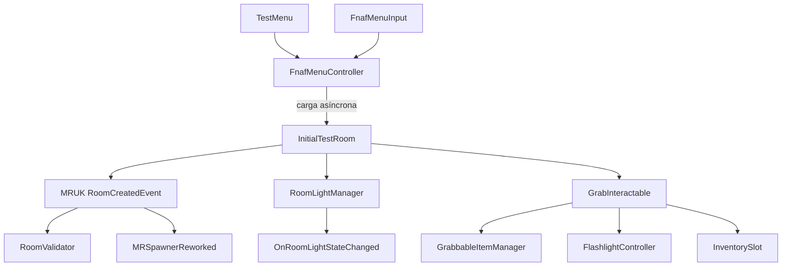

# Arquitectura

## Visión general

El proyecto es una aplicación Unity 6 para Android/Meta Quest. El runtime combina una escena de menú 3D con una escena de prueba MR basada en MRUK. Las dependencias de XR, render y Meta se configuran mediante `Packages/`, `ProjectSettings/` y las carpetas `Assets/XR`, `Assets/XRI` y `Assets/Settings`.

El código propio está en el espacio de nombres global y se organiza por responsabilidad:

| Área | Responsabilidad |
|---|---|
| `Menu` | Estado del menú, punteros, retícula, foco visual y poses de los personajes |
| `Managers` | Validación de habitación, iluminación y visuales de controladores |
| `Items` | Spawning MR, linterna y acciones asociadas a objetos agarrados |
| `Inventory` | Slots físicos, seguimiento de cintura y compatibilidad de objetos |
| `Debbug` | Paneles y atajos de depuración |
| `DriveCharacters` | Marcadores IK y idle procedural de personajes |

`Assets/MRTemplateAssets/MRTemplate.asmdef` encapsula el ensamblado de scripts de plantilla. Los scripts de `GameStuff` no declaran un ensamblado propio.

## Flujo de ejecución

1. `TestMenu` presenta splash, menú principal y ajustes mediante `FnafMenuController`.
2. `FnafMenuInput` calcula el puntero de cada mano, muestra retícula/laser y comunica la selección al controlador.
3. El botón de inicio resuelve la ruta configurada y carga `InitialTestRoom` de forma asíncrona.
4. MRUK crea la habitación. `RoomValidator` escucha `MRUK.Instance.RoomCreatedEvent`, comprueba las etiquetas requeridas y conserva la mesa más cercana.
5. `MRSpawnerReworked` escucha el mismo evento, selecciona una superficie compatible y coloca el prefab con padding, margen, superficie y rotación configurables.
6. `RoomLightManager` coordina passthrough, luz virtual, estados y parpadeo. Publica `OnRoomLightStateChanged` para consumidores que necesiten reaccionar al cambio.
7. Los objetos agarrables usan `GrabInteractable.WhenStateChanged`. `GrabbableItemManager`, `GrabbedObjectButton`, `FlashlightController` e `InventorySlot` reaccionan al ciclo de agarre/liberación.

## Patrones y dependencias

- **Eventos:** MRUK notifica la creación de la habitación; `RoomLightManager` expone un evento C# estático para cambios de luz; los componentes de interacción se suscriben a `WhenStateChanged`.
- **Referencias serializadas:** escenas y prefabs proporcionan cámaras, luces, CanvasGroups, transforms, prefabs y objetos de interacción desde el Inspector.
- **Búsqueda de fallback:** algunos managers usan `FindAnyObjectByType`/`FindFirstObjectByType` cuando una referencia opcional no está asignada.
- **Estado de menú:** `FnafMenuController.MenuScreen` diferencia splash, menú principal y ajustes y controla la interactividad de cada panel.
- **Slots activos:** `InventorySlot` mantiene un registro estático de slots activos para elegir el slot compatible más cercano.
- **Animación e IK:** los Animator Controllers de `DriveCharacters` se combinan con referencias a targets para poses e idle procedural.

## Límites conocidos

La arquitectura descrita es la observada en assets versionados y no sustituye una validación de ejecución. La detección MR, permisos, passthrough, seguimiento de manos y rendimiento deben comprobarse en un Quest real.

El contenido de `MRTemplateAssets`, `MetaAssets` y `Samples` mezcla recursos de plantilla o paquetes con contenido del juego. Se documenta como dependencia/soporte, no como código original del fangame.
