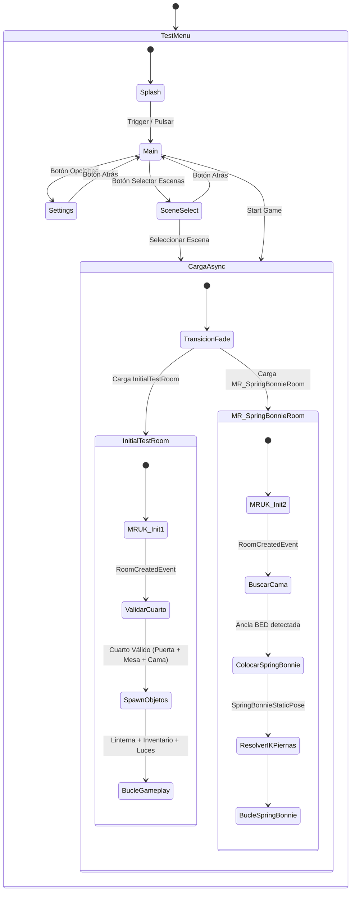

# Arquitectura del Sistema — FNaF MR

Este documento describe la arquitectura de software, los subsistemas técnicos, el flujo de ejecución y las dependencias de **Untiteled FNaF MR fangame** en Unity 6 (URP) para Meta Quest 3.

---

## 1. Visión General del Runtime

El proyecto está diseñado sobre una arquitectura modular basada en componentes (`MonoBehaviour`), donde los subsistemas se comunican principalmente mediante **eventos de ciclo de vida**, **eventos estáticos C#** y **suscripciones de estado** del SDK de Meta XR.

Todo el código propio de gameplay reside en el espacio de nombres global bajo `Assets/GameStuff/Scripts/`, estructurado por dominios de responsabilidad:

| Directorio | Dominio | Responsabilidad Técnica |
|---|---|---|
| `Characters/` | Personajes MR | Posicionamiento dinámico en superficies MRUK y cinemática inversa (IK) de animatrónicos. |
| `Debbug/` | Diagnóstico | Control en tiempo de ejecución de iluminación, parpadeo y generación de prefabs mediante UI flotante. |
| `DriveCharacters/` | Rigs y Animación | Animación procedural (respiración, oscilación de cabeza y fijación de pies). |
| `Hands/` | Manos del Jugador | Sustitución de mandos por manos esqueléticas con animación analógica de dedos. |
| `Interactions/` | Interacción y Oclusión | Contornos visuales (*highlights*) y control de oclusión por profundidad al agarrar objetos. |
| `Inventory/` | Inventario Físico | Slots corporales fijados a la cintura con detección de proximidad y acople magnético (*snap*). |
| `Items/` | Objetos de Juego | Controlador de linterna, mapeo de botones en agarre y colocación en geometría MRUK. |
| `Managers/` | Orquestadores | Validación de habitación real, iluminación global/passthrough y oclusión de entorno. |
| `Menu/` | Interfaz y Menú | Máquina de estados de menú 3D, seguimiento de mirada y punteros interactivos. |
| `Editor/` | Herramientas | Ventana de edición de poses (`RigPoseWindow`) y automatizaciones en `Assets/Editor/`. |

---

## 2. Subsistemas Principales

### 2.1 Reconstrucción del Entorno y Validación (MRUK)
1. Al cargar una escena MR (`InitialTestRoom` o `MR_SpringBonnieRoom`), **Meta Mixed Reality Utility Kit (MRUK)** genera los anclajes de habitación del mundo real.
2. `RoomValidator` se suscribe a `MRUK.Instance.RoomCreatedEvent`:
   - Itera sobre las anclas de la habitación inspeccionando `MRUKAnchor.SceneLabels`.
   - Verifica los requisitos mínimos: al menos una **puerta** (`DOOR_FRAME`), una **mesa** (`TABLE`) y una **cama o sofá** (`BED` o `COUCH`).
   - Identifica y conserva la referencia a la mesa más cercana a la cabeza del jugador.
3. `MRSpawnerReworked` escucha el mismo evento:
   - Identifica la cara correcta del volumen o plano detectado.
   - Aplica márgenes de seguridad (`borderMargin`), separación (`surfacePadding`) y rotación para posicionar prefabs (ej. `Flashlight`) sin que caigan o atraviesen la geometría.
4. `MRSpringBonniePlacement` (en `MR_SpringBonnieRoom`):
   - Localiza el ancla de cama (`BED`) más cercana al jugador.
   - Proyecta la cadera del modelo sobre el borde de la superficie real orientándolo hacia la zona despejada de la habitación.
   - Invoca a `SpringBonnieStaticPose` para resolver mediante IK de dos huesos las piernas contra el suelo de la habitación.

### 2.2 Iluminación y Oscuridad de Realidad Mixta
1. **Passthrough y Luz Virtual:**
   - `RoomLightManager` ajusta en tiempo de ejecución el brillo y contraste del mundo real mediante `OVRPassthroughLayer.SetBrightnessContrastProperties()`.
   - Modula en paralelo la intensidad de la luz virtual principal (`mainVirtualLight`).
   - Expone el evento C# estático:
     ```csharp
     public static event Action<bool> OnRoomLightStateChanged;
     ```
   - Ejecuta rutinas de parpadeo estroboscópico (`TriggerFlicker`).
2. **Shaders de Oscuridad y Revelado:**
   - `Custom/MR_UltimateDarknessRevealer` oscurece la habitación real renderizada en el passthrough y revela los elementos cuando el cono de luz de la linterna incide sobre ellos.
   - `Custom/MR_DirectLightOnly` asegura que los objetos virtuales en la penumbra se vean puramente negros y opacos ante la ausencia de luz directa, suprimiendo la iluminación ambiental y reflejos.

### 2.3 Oclusión por Profundidad (Meta Depth API)
1. `MRDepthOcclusionController` verifica la compatibilidad de `EnvironmentDepthManager` y el estado de passthrough.
2. Controla la propiedad global `_EnvironmentDepthBias` consumida por los shaders del proyecto.
3. Notifica a través del evento:
   ```csharp
   public static event Action<bool> OnOcclusionActiveChanged;
   ```
4. `DepthOcclusionOnGrab`:
   - Escucha `GrabInteractable.WhenStateChanged` de Meta Interaction SDK.
   - Cuando el jugador sostiene un objeto con sus manos reales, desactiva temporalmente la oclusión por profundidad del objeto (mediante `MaterialPropertyBlock` con `_DepthOcclusion = 0` o cambiando a materiales base sin oclusión) para evitar que las manos del usuario ocluyan erróneamente el objeto sujetado. Al soltarlo, restaura la oclusión con el entorno.

### 2.4 Manos y Agarre
1. **Visuales y Agarre:**
   - La interacción física se basa en `Oculus.Interaction.GrabInteractable`.
   - `GrabbableItemManager` oculta los controladores cuando el objeto pasa al estado de selección (`InteractableState.Select`) y restaura las físicas de `Rigidbody` al liberarse.
   - `GrabbedObjectButton` detecta la mano que sujeta el objeto y traduce pulsaciones de `OVRInput.Button` (ej. thumbstick) a eventos Unity (`UnityEvent`).
2. **Manos Virtuales FNaF:**
   - `PlayerHandsVR` permite sustituir los mandos estándar por mallas riggeadas de FNaF Help Wanted.
   - `FnafHandPose` lee las entradas analógicas de `OVRInput` (gatillo, grip, pulsación) y calcula los ángulos de flexión en las falanges de los dedos.

### 2.5 Inventario Físico de Cintura
1. `InventoryBodyFollower` proyecta la posición de la cabeza del jugador (`headTransform`) sobre el plano horizontal a la altura de la cintura (`heightOffset`) aplicando un suavizado lerp (`smoothSpeed`).
2. `InventorySlot` registra estáticamente todos los slots activos del jugador. Al detectar un objeto con el tag `KeepableObject` mediante triggers de física, evalúa si es compatible con la máscara de `InventoryItem` (`InventorySlotKind`).
3. Tras un frame de estabilización física post-liberación, acopla el objeto en el punto de anclaje (`snapPoint`) convirtiendo su `Rigidbody` en cinemático.

### 2.6 Menú e Interfaz
1. `FnafMenuController` implementa la máquina de estados de UI:
   - `Splash` -> `Main` -> `Settings` / `SceneSelect` -> `Transition`.
   - Realiza cargas asíncronas de escenas mediante `SceneManager.LoadSceneAsync` con fundidos a negro (`fadeOverlay`).
2. `FnafMenuInput` proyecta punteros láser desde los mandos (con fallback de ratón para el Editor) y emite eventos de selección por trigger.

---

## 3. Diagramas de Flujo y Dependencias

### 3.1 Flujo de Navegación y Estados de Escena



### 3.2 Mapa de Dependencias entre Componentes

```mermaid
graph TD
    subgraph Meta_SDK [Meta XR SDK & MRUK]
        MRUK[MRUK.Instance]
        GrabInt[GrabInteractable]
        DepthAPI[EnvironmentDepthManager]
        OVRIn[OVRInput]
        PassL[OVRPassthroughLayer]
    end

    subgraph Managers_Domain [Dominio Managers]
        RV[RoomValidator]
        RLM[RoomLightManager]
        DOC[MRDepthOcclusionController]
        GIM[GrabbableItemManager]
        VM[VisualsManager]
    end

    subgraph Items_Domain [Dominio Items e Inventario]
        SPAWN[MRSpawnerReworked]
        FLASH[FlashlightController]
        GOB[GrabbedObjectButton]
        ISLOT[InventorySlot]
        IITEM[InventoryItem]
        IBF[InventoryBodyFollower]
    end

    subgraph Characters_Domain [Personajes y Manos]
        SBP[MRSpringBonniePlacement]
        SBSP[SpringBonnieStaticPose]
        PHVR[PlayerHandsVR]
        FHP[FnafHandPose]
        DOG[DepthOcclusionOnGrab]
        IH[InteractableHighlight]
    end

    %% Relaciones
    MRUK -->|RoomCreatedEvent| RV
    MRUK -->|RoomCreatedEvent| SPAWN
    MRUK -->|RoomCreatedEvent| SBP
    PassL --> RLM
    DepthAPI --> DOC
    GrabInt --> GIM
    GrabInt --> GOB
    GrabInt --> DOG
    GrabInt --> IH
    GrabInt --> ISLOT
    OVRIn --> GOB
    OVRIn --> PHVR

    SBP --> SBSP
    SBP --> SPAWN
    PHVR --> FHP
    DOG --> DOC
    RLM -->|OnRoomLightStateChanged| FLASH
    GIM -.->|Find fallback| VM
    ISLOT <--> IITEM
```



---

## 4. Ensamblados y Convenciones de Código

- **Sin Asmdef Propio:** Los scripts en `Assets/GameStuff/Scripts/` compilan en el ensamblado principal `Assembly-CSharp.dll`, permitiendo comunicación directa y acceso a todos los paquetes importados.
- **Ensamblados de Plantilla:** `Assets/MRTemplateAssets/MRTemplate.asmdef` aísla los scripts heredados de la plantilla de Meta.
- **Suscripciones Seguras:** Los componentes que escuchan eventos de Meta/MRUK se suscriben en `OnEnable()` o `Start()` y se desuscriben estrictamente en `OnDisable()` o `OnDestroy()`, protegiendo la ejecución ante recargas de escena.
